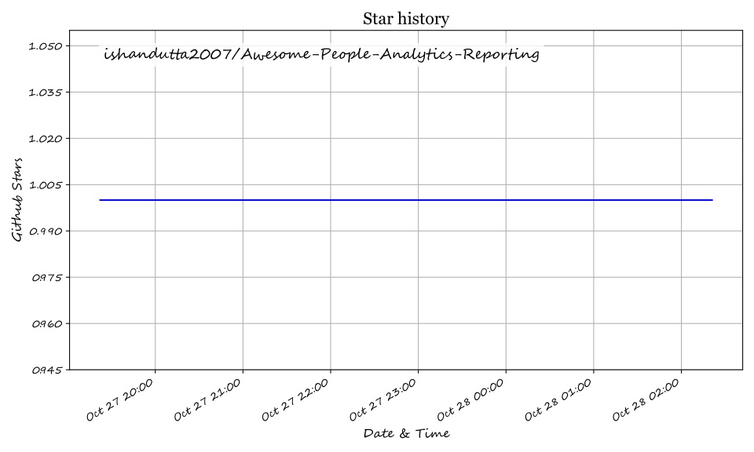

<p align="center">
  
</p>

<p align="center">
  <a href="https://github.com/ishandutta2007/Awesome-Awesome-Awesome"></a><a href="https://discord.gg/jc4xtF58Ve"></a>
  <a href="https://github.com/ishandutta2007/Awesome-People-Analytics-Reporting/stargazers"></a>
  <a href="https://github.com/ishandutta2007/Awesome-People-Analytics-Reporting/network/members"></a>
  <a href="https://github.com/ishandutta2007/Awesome-People-Analytics-Reporting/blob/main/LICENSE"></a>
  <a href="https://github.com/ishandutta2007/Awesome-People-Analytics-Reporting/pulls"></a>
  <a href="https://github.com/ishandutta2007"></a>
</p>

---

# 📊 Awesome People Analytics & HR Reporting

> 🚀 **A curated directory of enterprise SaaS workforce intelligence platforms, open-source HR analytics tools, turnover prediction models, organizational design software, and data pipelines for evidence-based people operations.**

Whether you are a Chief Human Resources Officer (CHRO), People Analytics Director, HR Data Engineer, or People Ops Specialist, this repository serves as a centralized index of platforms and frameworks designed to transform workforce data into strategic business impact.

---

## 📑 Table of Contents

- [🌐 Sector Overview & Market Dynamics](#-sector-overview--market-dynamics)
- [🏢 SaaS & Hosted Workforce Analytics Platforms](#-saas--hosted-workforce-analytics-platforms)
- [🔓 Open-Source GitHub Projects](#-open-source-github-projects)
- [🛠️ Architectural Guidance & Stack Selection](#️-architectural-guidance--stack-selection)
- [🤝 How to Contribute](#-how-to-contribute)
- [📈 Star History](#-star-history)
- [💖 Support](#-support)
- [⚖️ Disclaimer & Privacy Compliance](#️-disclaimer--privacy-compliance)

---

## 🌐 Sector Overview & Market Dynamics

The global **People Analytics and Workforce Intelligence Software Market** is currently valued at approximately **$3.6 Billion to $4.2 Billion** and is projected to expand at a compound annual growth rate (**CAGR**) of **14.2% to 15.8%**, surpassing **$9.0 Billion by 2032**. This robust expansion is propelled by executive demand for predictive attrition models, skills-gap mapping, pay equity compliance (such as EU Pay Transparency directives), and hybrid workforce productivity tracking.

Market concentration follows a **bimodal, moderately fragmented structure**:
1. **Concentrated Enterprise Layer:** Multi-billion-dollar enterprise HCM suites (e.g., Workday, SAP) and general BI giants (Microsoft Power BI, Tableau) capture foundational reporting and regulatory headcount reporting via enterprise licensing agreements.
2. **Moderately Fragmented Pure-Play Layer:** Specialized people intelligence providers (e.g., Visier, One Model, ChartHop, Orgvue, Crunchr) drive technological innovation in predictive AI flight risk, continuous organizational network analysis (ONA), and workforce data mesh architectures. The pure-play market remains highly dynamic and competitive, avoiding single-vendor monopolization due to heterogeneous HR tech stacks and complex employee data governance requirements.

---

## 🏢 SaaS & Hosted Workforce Analytics Platforms

The table below outlines leading commercial SaaS solutions for workforce intelligence, talent analytics, headcount planning, and HR executive dashboards. Entries are **sorted in descending order by company scale** (market capitalization, enterprise valuation, or annual revenue).

| 🏢 Platform | 💼 Core Capabilities & Workforce Scope | 📊 Company Scale (Valuation / Revenue) | 💵 Starting Pricing | 🎁 Free Tier / Free Trial Limits |
| :--- | :--- | :--- | :--- | :--- |
| **[Microsoft Power BI](https://powerbi.microsoft.com/)** | 📈 Enterprise self-service business intelligence & HR dashboarding; DAX-powered attrition modeling, native Azure Synapse & Microsoft 365 / Entra ID workforce connectors. | **~$3.10 Trillion** Market Cap<br>*(Microsoft Corp · $245.1B Rev)* | **$10.00 / user / month**<br>*(Power BI Pro tier; $20.00/user/mo for Power BI Premium Per User)* | 🟢 **Free Forever:** Power BI Desktop is 100% free for unlimited personal dashboard authoring and local analysis.<br>⏱️ **Free Trial:** 60-day fully functional trial for Power BI Pro Service (up to 10 GB workspace capacity). |
| **[Tableau](https://www.tableau.com/)** | 🎨 High-performance visual analytics & interactive HR executive dashboards; connects to Snowflake/BigQuery HR data lakes, turnover trend forecasting, and diversity metrics. | **~$280.0 Billion** Market Cap<br>*(Salesforce Inc · $34.9B Rev)* | **$15.00 / user / month**<br>*(Tableau Viewer; Tableau Explorer is $42.00/user/mo; Tableau Creator is $75.00/user/mo billed annually)* | 🟢 **Free Forever:** Tableau Public is free forever (limited to saving public workbooks, up to 10 GB storage).<br>⏱️ **Free Trial:** 14-day fully featured free trial of Tableau Cloud & Desktop with enterprise data connectors. |
| **[Workday Analytics & Reporting](https://www.workday.com/)** | 👔 Built-in enterprise HCM reporting suite, Workday Prism Analytics data hub, predictive attrition risk, talent pipeline health, and compensation benchmark integration. | **~$68.0 Billion** Market Cap<br>*(Workday Inc · $7.3B Rev)* | **~$100.00 – $150.00 / employee / year**<br>*(Enterprise HCM suite bundle; standard minimum annual contract floor of ~$100,000/year)* | ⏱️ **Free Trial:** 30-day guided interactive sandbox proof-of-concept (POC) environment with pre-populated workforce schemas for qualified enterprise evaluations. |
| **[Orgnostic](https://orgnostic.com/)** *(Culture Amp)* | 🧬 Diagnostic people analytics engine connecting HRIS, ATS, and engagement surveys; burnout detection, pay gap audits, retention driver modeling, and eNPS correlation. | **~$2.0 Billion** Valuation<br>*(Culture Amp · ~$150M ARR)* | **$4.00 / employee / month**<br>*(Culture Amp People Analytics module; annual contract starting floor of ~$4,500/year)* | ⏱️ **Free Trial:** 14-day free trial sandbox with full access to HRIS integrations, automated survey benchmarks, and sample organizational audit data. |
| **[Visier](https://www.visier.com/)** | 🧠 Purpose-built workforce intelligence platform with 2,000+ pre-built people metrics; Vee generative AI assistant, flight risk forecasting, and strategic headcount planning. | **~$1.0 Billion** Valuation<br>*(Series E Unicorn · ~$125M ARR)* | **~$10.00 – $15.00 / employee / year**<br>*(Visier Starter/Essentials; entry contract floor starting at $12,000/year)* | ⏱️ **Free Trial:** 30-day developer & evaluator sandbox trial with pre-loaded benchmark datasets and workforce intelligence templates (no credit card required). |
| **[ChartHop](https://www.charthop.com/)** | 🗺️ Dynamic org chart visualization, headcount planning, compensation review cycles, performance tracking, and real-time people operations dashboards. | **~$350 Million** Valuation<br>*(Series C · ~$20M ARR)* | **$4.00 / employee / month**<br>*(ChartHop Core plan; entry annual contract floor starting around $9,000/year)* | ⏱️ **Free Trial:** 14-day free trial of ChartHop Core & Modules with full access to org charting, directory, and real-time headcount dashboards. |
| **[Orgvue](https://www.orgvue.com/)** | 📐 Organizational design, workforce restructuring simulation, span-of-control optimization, talent cost modeling, and M&A integration analytics. | **~$220 Million** Valuation<br>*(Growth Stage · ~$45M ARR)* | **£65,000 / year (~$82,000 / year)**<br>*(Base enterprise subscription tier under UK G-Cloud procurement frameworks)* | ⏱️ **Free Trial:** 30-day guided proof-of-concept / evaluation tenant on client-sample anonymized org structures upon request during procurement review. |
| **[SplashBI](https://www.splashbi.com/)** | ⚡ Pre-built HR reporting apps and real-time connectors for Oracle Cloud HCM, SAP SuccessFactors, Workday, and ADP; turnover and benefit cost analytics. | **~$110 Million** Valuation<br>*(Mid-Market · ~$25M ARR)* | **$9.99 / user / month**<br>*(Starting reporting package; enterprise HR connector suites start at ~$15,000/year)* | ⏱️ **Free Trial:** 14-day cloud sandbox free trial with pre-loaded HR data schemas and ready-to-use executive workforce dashboard templates. |
| **[One Model](https://www.onemodel.co/)** | 🏛️ People Data Cloud & enterprise workforce data warehouse; automated ETL orchestration, One AI automated attrition machine learning, and data mesh integrations. | **~$100 Million** Valuation<br>*(Series B · ~$15M ARR)* | **$1,000.00 / first month**<br>*(One AI Trailblazer intro program; core platform essentials start at ~$35,000/year)* | ⏱️ **Free Trial:** 30-day guided evaluation pilot with custom data pipeline ingestion on up to 2 core HR data sources. |
| **[Crunchr](https://www.crunchr.com/)** | 🔍 Self-service people analytics & workforce planning platform; attrition predictive algorithms, diversity & inclusion metrics, and skill gap forecasting. | **~$45 Million** Valuation<br>*(Randstad Innovation Fund · ~$10M ARR)* | **$3.82 / employee / month**<br>*(Billed annually; entry minimum baseline starting at ~$18,000/year for mid-market cohorts)* | ⏱️ **Free Trial:** 14-day interactive live sandbox demo with sample organizational rosters, turnover drivers, and retention modeling. |

---

## 🔓 Open-Source GitHub Projects

Below is a curated selection of open-source HRMS platforms with built-in analytics modules, open-source BI frameworks for workforce data lakes, dedicated people analytics libraries, turnover prediction engines, and organizational network analysis repositories.

Entries are **sorted in descending order by GitHub Stars_Count**, with real-time Stars_Badges linking directly to each repository's stargazers page.

### 🌟 Ranked Open-Source Repositories

1. **[Apache Superset](https://github.com/apache/superset)** [](https://github.com/apache/superset/stargazers)  
   *Enterprise-grade, modern open-source business intelligence and data visualization platform (Python/Flask/React).*  
   - **HR Analytics Utility:** Widely deployed as the visualization layer atop HR data lakes (Snowflake, Trino, PostgreSQL); includes customizable SQL-based executive talent dashboards, attrition heatmaps, and role-based access control (RBAC) to enforce strict employee data privacy.

2. **[Metabase](https://github.com/metabase/metabase)** [](https://github.com/metabase/metabase/stargazers)  
   *Intuitive, self-service open-source business intelligence and dashboarding tool (Clojure/JavaScript).*  
   - **HR Analytics Utility:** Enables non-technical HR business partners (HRBPs) to query workforce databases using visual query builders without SQL; provides automated email/Slack alerts for headcount spikes and monthly turnover anomalies.

3. **[Frappe HR](https://github.com/frappe/hrms)** [](https://github.com/frappe/hrms/stargazers)  
   *Comprehensive, modern open-source Human Resource Management System (AGPL-3.0, Python/Frappe/JS).*  
   - **HR Analytics Utility:** The most feature-complete open-source HR foundation; includes native reporting modules for employee lifecycle trends, leave utilization, absenteeism, payroll expense distribution, and appraisal metrics; integrates seamlessly with ERPNext.

4. **[Horilla HR](https://github.com/horilla/horilla-hr)** [](https://github.com/horilla/horilla-hr/stargazers)  
   *Free and open-source HR management software with a clean, modern UI (LGPL-2.1, Python/Django).*  
   - **HR Analytics Utility:** Features visual reporting widgets covering recruitment conversion funnels, attendance records, departmental headcount breakdowns, and employee performance tracking; Docker-deployable for private self-hosting.

5. **[OrangeHRM](https://github.com/orangehrm/orangehrm)** [](https://github.com/orangehrm/orangehrm/stargazers)  
   *Veteran open-source HRM system established in 2005 (GPL, PHP/Symfony).*  
   - **HR Analytics Utility:** Contains an out-of-the-box reporting and analytics module generating operational summaries on headcount distribution, time-off patterns, employee turnover, and talent acquisition metrics.

6. **[Frappe Insights](https://github.com/frappe/insights)** [](https://github.com/frappe/insights/stargazers)  
   *100% open-source BI and data exploration platform (Frappe Framework, Python/Vue.js).*  
   - **HR Analytics Utility:** Connects directly to HR databases (PostgreSQL, MySQL, MariaDB) to build custom workforce dashboards; visual drag-and-drop query builder lets HR analysts build turnover and compensation charts without writing SQL.

7. **[MintHCM](https://github.com/minthcm/minthcm)** [](https://github.com/minthcm/minthcm/stargazers)  
   *Open-source Human Capital Management platform based on SugarCRM/SuiteCRM heritage (AGPL).*  
   - **HR Analytics Utility:** Delivers workforce monitoring, skills management, and customizable reporting on employee turnover, recruitment cycle times, and operational HR metrics.

8. **[people-analytics-rstats](https://github.com/rstudio-conf-2022/people-analytics-rstats)** [](https://github.com/rstudio-conf-2022/people-analytics-rstats/stargazers)  
   *RStudio Conference curated workshop and toolkit for People Analytics in R (R / Quarto).*  
   - **HR Analytics Utility:** End-to-end analytical notebooks illustrating employee survey sentiment analysis, turnover survival analysis, and organizational network analysis using the tidyverse and Tidymodels.

9. **[peopleanalytics-regression-book](https://github.com/keithmcnulty/peopleanalytics-regression-book)** [](https://github.com/keithmcnulty/peopleanalytics-regression-book/stargazers)  
   *Complete companion codebase and datasets for the 'Handbook of Regression Modeling in People Analytics' by Keith McNulty (R).*  
   - **HR Analytics Utility:** In-depth implementations of binomial, multinomial, proportional odds, and survival regressions applied to employee promotion, attrition, and diversity modeling.

10. **[InsightForge HR Analytics](https://github.com/virajbhutada/InsightForge)** [](https://github.com/virajbhutada/InsightForge/stargazers)  
    *Curated portfolio collection of interactive Power BI dashboards and DAX analytical models.*  
    - **HR Analytics Utility:** Includes production-ready HR analytics dashboards tracking employee attrition drivers, tenure distributions, performance ratings, and executive workforce scorecards.

11. **[ona_book (Org Network Analysis)](https://github.com/keithmcnulty/ona_book)** [](https://github.com/keithmcnulty/ona_book/stargazers)  
    *Code and data repository for the 'Handbook of Graphs and Networks in People Analytics' (R / igraph / ggraph).*  
    - **HR Analytics Utility:** Practical guides to analyzing informal organizational structures, cross-team collaboration silos, centrality metrics, and team integration using network graph algorithms.

12. **[HR-Analytics](https://github.com/sharmaroshan/HR-Analytics)** [](https://github.com/sharmaroshan/HR-Analytics/stargazers)  
    *Data analytics and machine learning classification project for corporate promotion criteria (Python/Jupyter).*  
    - **HR Analytics Utility:** Analyzes employee key performance indicators (KPIs), training scores, and demographic factors to uncover promotion equity and predict advancement readiness.

13. **[IBM-HR-Analytics-Employee-Attrition](https://github.com/mrc03/IBM-HR-Analytics-Employee-Attrition-Performance)** [](https://github.com/mrc03/IBM-HR-Analytics-Employee-Attrition-Performance/stargazers)  
    *End-to-end exploratory data analysis and ML classification pipeline for IBM HR workforce data (Python/scikit-learn).*  
    - **HR Analytics Utility:** Features Recursive Feature Elimination (RFE), SMOTE class balancing, and cross-model benchmarks (Random Forest, XGBoost) to diagnose flight risk drivers.

14. **[hr_data](https://github.com/teuschb/hr_data)** [](https://github.com/teuschb/hr_data/stargazers)  
    *Synthetic HR datasets, benchmarking routines, and exploratory scripts for People Analytics experimentation (R / Python).*  
    - **HR Analytics Utility:** Provides realistic, non-confidential employee records for testing attrition algorithms, span of control models, and organizational network visualizations without exposing real PII.

15. **[HR-Analytics-PowerBI](https://github.com/Pandey-Adarsh/HR-Analytics-PowerBI)** [](https://github.com/Pandey-Adarsh/HR-Analytics-PowerBI/stargazers)  
    *Comprehensive HR analytics portfolio project analyzing workforce metrics across 80,000+ records (Power BI / Power Query / DAX).*  
    - **HR Analytics Utility:** Demonstrates automated ETL, custom DAX measures for voluntary vs. involuntary turnover, and executive dashboard layout design.

16. **[PeopleAnalytics_Turnover](https://github.com/brunokatekawa/PeopleAnalytics_Turnover)** [](https://github.com/brunokatekawa/PeopleAnalytics_Turnover/stargazers)  
    *Interactive web application and machine learning model predicting employee turnover risk (Python / Streamlit).*  
    - **HR Analytics Utility:** Identifies staff at elevated risk of departure by analyzing job satisfaction, role tenure, compensation ratios, and historical departmental attrition.

17. **[Employee-Performance-Analytics](https://github.com/AmirhosseinHonardoust/Employee-Performance-Analytics)** [](https://github.com/AmirhosseinHonardoust/Employee-Performance-Analytics/stargazers)  
    *SQL and Python data engineering pipeline for employee productivity and departmental KPI aggregation.*  
    - **HR Analytics Utility:** Provides automated calculation of workload balance, efficiency trends, and performance quartile distributions for HR business partner decision-making.

18. **[hR (Worker Data Engineering)](https://github.com/dalekube/hR)** [](https://github.com/dalekube/hR/stargazers)  
    *R package and data manipulation framework tailored specifically for Human Resources data structures.*  
    - **HR Analytics Utility:** Simplifies complex HR calculations such as hierarchy roll-ups, tenure duration factoring, supervisory span computation, and point-in-time headcount census transformations.

19. **[Farik](https://github.com/SamoTech/Farik)** [](https://github.com/SamoTech/Farik/stargazers)  
    *Modern, lightweight open-source HR platform for agile teams (MIT, TypeScript/Node).*  
    - **HR Analytics Utility:** Delivers built-in dashboard analytics tracking live team capacity, attendance health, flight risk forecasts, and team burnout indicators.

---

## 🛠️ Architectural Guidance & Stack Selection

```
┌────────────────────────────────────────────────────────────────────────┐
│                   PEOPLE DATA ARCHITECTURE LAYERS                      │
├────────────────────────────────────────────────────────────────────────┤
│ 1. Core HRIS Layer     │ Frappe HR, OrangeHRM, Workday, BambooHR      │
│ 2. Pipeline / ETL      │ Meltano, Airbyte, Python (dbt / Pandas)       │
│ 3. Storage / Warehouse │ PostgreSQL, Snowflake, BigQuery, ClickHouse   │
│ 4. BI & Dashboards     │ Apache Superset, Metabase, Power BI, Tableau │
│ 5. Advanced ML / ONA   │ R (Tidyverts/igraph), Python (scikit-learn)   │
└────────────────────────────────────────────────────────────────────────┘
```

Because off-the-shelf open-source people analytics platforms are not as unified as general business intelligence platforms, most organizations adopt one of two architectural patterns:

1. **Commercial All-in-One Route:** Deploy **Visier**, **One Model**, or **ChartHop** on top of your existing HRIS (Workday, UKG, BambooHR) to gain immediate access to out-of-the-box flight risk AI, industry compensation benchmarks, and pre-built executive dashboards.
2. **Open-Source Modular Stack:** Pair an operational HR foundation (**Frappe HR** or **Horilla**) with an open-source data warehouse (PostgreSQL / ClickHouse) and BI layer (**Apache Superset** or **Metabase**), orchestrating custom ML models using **Keith McNulty's regression & ONA frameworks**.

---

## 🤝 How to Contribute

Contributions from the people analytics, HR data science, and workforce intelligence communities are warmly welcomed!

1. 🍴 **Fork the Repository** to your personal GitHub account.
2. 🌿 **Create a Feature Branch** (`git checkout -b feature/add-new-pa-tool`).
3. 📝 **Add Your Resource** to `README.md` following the tabular or bulleted format (include specific starting pricing, factual capabilities, and official hyperlinks).
4. 🏷️ **Add GitHub Social Stars_Badges** for open-source additions linking to the stargazers page.
5. 🚀 **Submit a Pull Request (PR)** with a clear explanation of why the tool adds value to people analytics professionals.

---

## 📈 Star History

[](https://star-history.dera.page/#ishandutta2007/Awesome-People-Analytics-Reporting&type=date&legend=top-left)

---

## 💖 Support

If you find this repository valuable for your workforce planning, talent analytics research, or HR engineering projects, please consider supporting the project:

- ⭐ **Star this repository** to improve its visibility across the GitHub ecosystem.
- 🍴 **Fork and share** it with your People Ops, HRBP, and Data Science networks.
- ☕ **Sponsor or Buy a Coffee:** You can support the ongoing curation and maintenance via the **[GitHub Sponsor Dashboard](https://github.com/sponsors/ishandutta2007)**.

Thank you to all our contributors, star-gazers, and HR tech innovators! 🙌

---

## ⚖️ Disclaimer & Privacy Compliance

- 🛡️ **Privacy & Data Governance:** People analytics involves sensitive employee data. All implementations must adhere strictly to relevant privacy regulations (**GDPR**, **CCPA**, **EEOC compliance**, and **EU Pay Transparency**). Predictive models (such as flight risk or performance clustering) must be audited regularly for unintended bias or disparate impact.
- 📜 **Licensing:** Verify all licenses prior to commercial deployment. Open-source tools listed here are licensed under AGPL-3.0, LGPL-2.1, GPL, MIT, or Apache-2.0.
- 🔍 **Neutrality:** Mentions of commercial SaaS platforms do not constitute paid endorsements; listings are curated based on industry relevance, market adoption, and technical capabilities.

## Star History

<a href="https://star-history.com/#ishandutta2007/Awesome-People-Analytics-Reporting&Timeline" align="center">
  <picture>
    <source media="(prefers-color-scheme: dark)" srcset="assets/ishandutta2007_Awesome-People-Analytics-Reporting_growth.svg">
    
  </picture>
</a>
